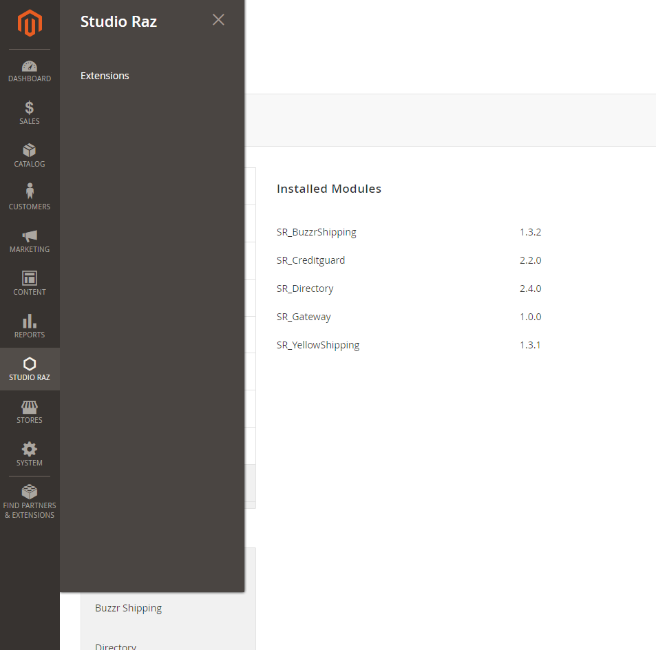
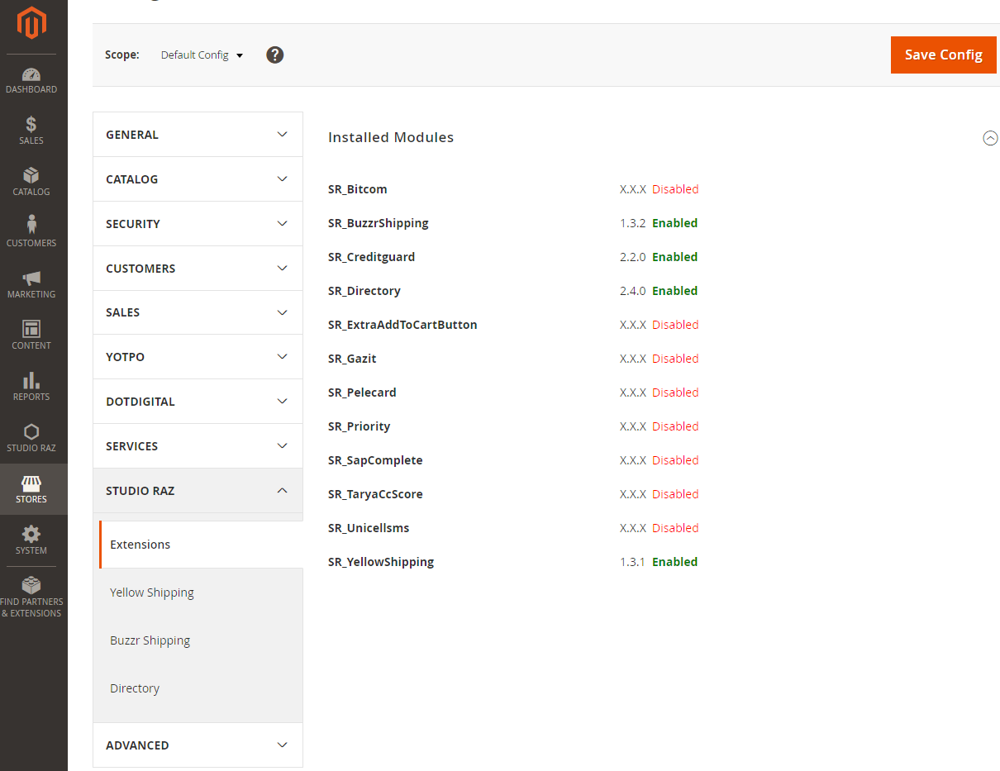

# Magento 2 module. Base module for Studio Raz's modules.
 
A base module for ALL Studio Raz modules. 

The module list installed SR modules on the current site. see screenshot below. 

In addition, it adds 2 extra features that should be utilized by dependent modules: 

### Backend Menu
The module adds a menu item to allow dependent modules add their own links. 
When creating new menu item link in `etc/adminhtml/menu.xml` in order to append it to Studio Raz menu item set `parent="SR_Base::srbase"` 
```xml
<config>
    <menu>        
        <add ... parent="SR_Base::srbase" ... />
    </menu>
</config>
```



### System Configuration Tab
The module adds a system configuration tab that other dependent modules can hook to.
When creating a new system configuration section in `etc/adminhtml/system.xml` in order to append it to Studio Raz tab add `<tab>studioraz</tab>` to it:
```xml
<config>
    <system>
        <section>
            ...
            <tab>studioraz</tab>
            ....
        </section>
    </system>
</config> 
```



## Releases

Releases follow the [shared Release Please guide](https://github.com/studioraz/ci-templates/blob/master/docs/release-please.md).
Use Conventional Commit PR titles (`feat: add support`, `fix: correct behavior`).
Squash merges use the PR title and body; single-commit PRs must have a matching commit title.

Pushes to `master`, the Monday 06:00 UTC schedule and manual runs maintain the release PR and synchronize shared configuration.
Merging a release PR creates a GitHub Release and an unprefixed SemVer tag, and updates the root `CHANGELOG.md`.
Enrollment preserves existing release history (verified baseline `1.9.0`).

The optional `RELEASE_TOKEN` is forwarded to the shared workflow. Without it, `GITHUB_TOKEN` is used and bot-created PRs do not trigger PR-title CI. Supply a PAT or GitHub App token when those checks are required.
